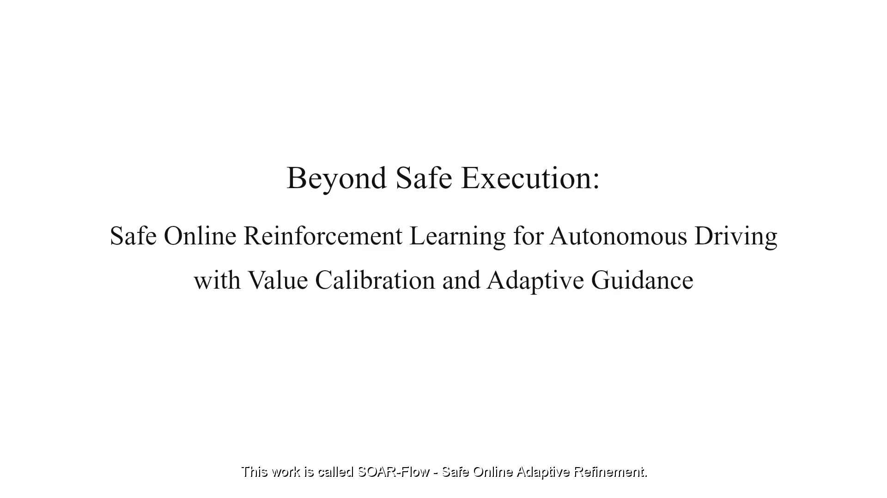

<div align="center">

# SOAR-Flow

### Beyond Safe Execution: Safe Online Reinforcement Learning for Autonomous Driving with Value Calibration and Adaptive Guidance

Zeqiao Li · Yijing Wang · Haoyu Wang · Zheng Li · Zhiqiang Zuo · Chuan Hu


[](https://lzqw.github.io/SOAR-Flow/)

**Safe interaction · calibrated values · fewer corrections**

</div>

<p align="center">
  <a href="https://lzqw.github.io/SOAR-Flow/"></a>
</p>

<p align="center"><a href="https://lzqw.github.io/SOAR-Flow/"><strong>▶ Watch the full 2:54 video demo</strong></a></p>

SOAR-Flow is a safe online refinement framework for offline-initialized Flow driving policies. A CBF–MPC filter certifies each reference before execution, Gaussian-return-aware calibration stabilizes value learning, and paired corrections together with intervention-to-go prediction help the policy learn behavior that needs fewer future corrections.

## What the video shows

| Time | Evidence |
| --- | --- |
| 00:00–00:25 | Flow policy, CBF–MPC certification, value calibration, and adaptive guidance |
| 00:25–01:22 | SafeMetaDrive policy-only, protected, intermediate, and refined execution |
| 01:22–02:10 | UGV blocked-side bypass and 8-shaped online refinement |
| 02:10–02:54 | Held-out cornering transfer and final comparison |

The demo contains English narration and subtitles. The downloadable subtitle track is [`video-transcript.srt`](video-transcript.srt).

## Method at a glance

```text
raw Flow reference → CBF–MPC certification → protected execution
          ↓                    ↓                       ↓
       actor update ← correction / intervention-to-go ← return calibration
```

The filter stays active during data collection and training. Learning signals are built from the certified transition, while the raw reference is retained for paired corrective updates. As predicted intervention demand falls, auxiliary guidance and calibration regularization are gradually relaxed.

## Reported results

- **Simulation:** SOAR-Flow reaches `352.3 ± 2.1` final return, with `0.18 ± 0.10` protected training cost and `0.72 ± 0.12%` correction rate.
- **Blocked-side UGV bypass:** `100%` safe success and `0.68 ± 0.11%` correction rate.
- **8-shaped UGV maneuver:** `100%` safe success and `15.36 ± 0.24 s` completion time.
- **Held-out cornering:** `95%` safe success without further policy updates.

See the paper for evaluation protocols, baselines, ablations, and the safety analysis.

## Files

| Path | Contents |
| --- | --- |
| [`docs/index.html`](https://lzqw.github.io/SOAR-Flow/) | Video-first project page for GitHub Pages |
| [`docs/assets/soar-flow-demo.mp4`](docs/assets/soar-flow-demo.mp4) | Full 2:54, 1080p demo video |
| [`video-transcript.srt`](video-transcript.srt) | English subtitle track |

## Paper

The arXiv link will be added here after the paper is announced.

## Availability

This repository presents the project and demonstration video. Implementation and data availability will be announced here.
